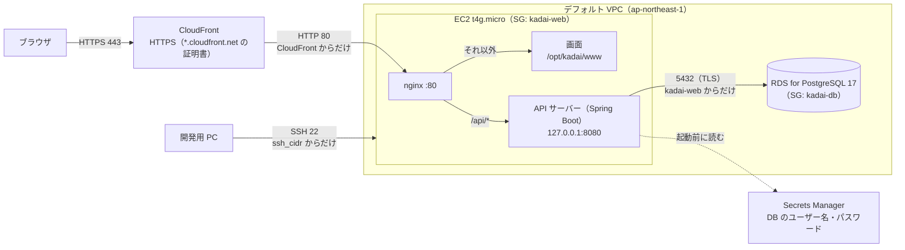

# 公開環境（AWS）

公開 URL は https://d8luytdd327lu.cloudfront.net 。AWS の東京リージョン（ap-northeast-1）で、CloudFront → EC2 1 台 → RDS の構成で動かしている。環境は Terraform で作り、アプリは `bash deploy/deploy.sh` で反映する。

設定値は主なものだけを書く。正確な値は [deploy/](../deploy/) のコードを見る。

## 目次

- [構成図](#構成図)
- [リソースと主な設定](#リソースと主な設定)
- [ファイルの置き場所](#ファイルの置き場所)
- [初めて環境を作る](#初めて環境を作る)
- [デプロイする](#デプロイする)
- [運用](#運用)
- [費用](#費用)
- [後片付け](#後片付け)
- [困ったとき](#困ったとき)

## 構成図



- 画面と API が同じ URL なので、画面のコードは開発中と同じ（`/api` への相対パス）で動き、CORS の設定は要らない
- CloudFront は `/api/*` をキャッシュしない。それ以外（画面のファイル）はキャッシュするが、nginx が `index.html` に `no-cache`、`/assets/`（ファイル名にハッシュ入り）に 1 年のキャッシュを付ける
- API サーバーと DB は、インターネットから直接は届かない

## リソースと主な設定

| リソース | 主な設定 | コード |
| --- | --- | --- |
| CloudFront | ブラウザ側は HTTPS のみ（HTTP はリダイレクト）。オリジンは EC2 の 80 番に HTTP。`/api/*` はキャッシュなし・全メソッド・クエリ文字列を転送。価格帯 PriceClass_200 | [cloudfront.tf](../deploy/terraform/cloudfront.tf) |
| EC2 | t4g.micro（ARM・1 GB）、Amazon Linux 2023、EBS gp3 10 GB、スワップ 2 GB。CPU クレジットは standard（追加料金なし）。Elastic IP 付き | [main.tf](../deploy/terraform/main.tf)、[user-data.sh](../deploy/terraform/user-data.sh) |
| セキュリティグループ `kadai-web`（EC2） | 受信は 80 番（CloudFront のプレフィックスリスト）と 22 番（`ssh_cidr`）だけ | [main.tf](../deploy/terraform/main.tf) |
| IAM ロール `kadai-ec2` | EC2 に付ける。RDS があるときだけ、DB のシークレットを読む権限が付く | [main.tf](../deploy/terraform/main.tf)、[rds.tf](../deploy/terraform/rds.tf) |
| RDS | PostgreSQL 17、db.t4g.micro、gp3 20 GB（暗号化あり）、シングル AZ、パブリックアクセスなし。自動バックアップ 1 日（7 日は無料プランでは拒否された）。削除保護あり。`enable_rds = true` のときだけ作る | [rds.tf](../deploy/terraform/rds.tf) |
| セキュリティグループ `kadai-db`（RDS） | 受信は 5432 番を `kadai-web` からだけ | [rds.tf](../deploy/terraform/rds.tf) |
| Secrets Manager | DB のパスワードは RDS が作って保存する（Terraform の state にも残らない）。7 日ごとに自動で変わる | [rds.tf](../deploy/terraform/rds.tf) |

EC2 の中の設定は次のとおり。どれも `deploy.sh` が [deploy/server/setup.sh](../deploy/server/setup.sh) で毎回最新にする。

| 何 | 設定 | ファイル |
| --- | --- | --- |
| nginx | 80 番で画面を返し、`/api/` を 127.0.0.1:8080 へ転送 | [nginx.conf](../deploy/server/nginx.conf) |
| API サーバー | systemd の `kadai` サービス。ユーザー `kadai` で動かし、ヒープは 384 MB。落ちても EC2 を再起動しても自動で起動する | [kadai.service](../deploy/server/kadai.service) |
| DB の接続情報 | 起動前に Secrets Manager から読み、`/run/kadai/db/` に置いて Spring Boot に渡す（`kadai` だけが読める） | [db-secret.sh](../deploy/server/db-secret.sh) |
| パスワードの変化の確認 | 10 分ごとに確かめ、変わっていたら API サーバーを再起動する | [kadai-db-secret-check.timer](../deploy/server/kadai-db-secret-check.timer) |

## ファイルの置き場所

```
deploy/
├── deploy.sh                 デプロイ（ビルド → EC2 へ転送 → 再起動 → 確認）
├── server/                   EC2 の設定（deploy.sh が毎回 EC2 に入れる）
│   ├── setup.sh                  nginx などの導入と設定ファイルの配置
│   ├── nginx.conf                → /etc/nginx/conf.d/kadai.conf
│   ├── kadai.service             → /etc/systemd/system/（API サーバー）
│   ├── db-secret.sh              → /opt/kadai/bin/（DB の接続情報を読む）
│   └── kadai-db-secret-check.*   → /etc/systemd/system/（パスワードの変化の確認）
└── terraform/                AWS の環境
    ├── versions.tf               Terraform とプロバイダーのバージョン
    ├── variables.tf              変数（region・instance_type・enable_rds・rds_deletion_protection・ssh_cidr）
    ├── main.tf                   EC2・Elastic IP・キーペア・kadai-web・IAM ロール
    ├── rds.tf                    RDS・kadai-db・シークレットを読む権限
    ├── cloudfront.tf             CloudFront
    ├── outputs.tf                公開 URL・接続先など（deploy.sh が読む）
    └── user-data.sh              EC2 の初回起動時の準備（Java 21・スワップなど）
```

手元にだけあり、リポジトリに入れないもの（`.gitignore` 済み）：

| ファイル | 中身 | 注意 |
| --- | --- | --- |
| `deploy/terraform/terraform.tfvars` | `ssh_cidr`（自分のグローバル IP）、`enable_rds` | |
| `deploy/terraform/kadai.pem` | SSH の秘密鍵（Terraform が作る） | 他の人に渡さない |
| `deploy/terraform/terraform.tfstate` | Terraform が作ったものの記録 | SSH の秘密鍵も入っている。消すと Terraform で管理できなくなる |

EC2 の中のアプリは `/opt/kadai/`（`app.jar`、画面の `www/`、反映したコミットの `COMMIT`）にある。

## 初めて環境を作る

必要なもの：開発で使っている JDK 21・Node.js・Git Bash に加えて、AWS CLI v2 と Terraform 1.9 以上。AWS CLI は `aws configure` でリージョン `ap-northeast-1` を設定し、`aws sts get-caller-identity` でアカウントが表示されることを確かめる（作業は IAM ユーザーで行う）。

1. `deploy/terraform/terraform.tfvars` を作る

   ```
   ssh_cidr   = "203.0.113.10/32"   # 自分のグローバル IP（curl https://checkip.amazonaws.com で調べる）
   enable_rds = true
   ```

2. 環境を作る（RDS は 6 分、CloudFront は 4 分ほどかかる）

   ```
   cd deploy/terraform
   terraform init
   terraform plan
   terraform apply
   terraform output url
   ```

3. `kadai` フォルダに戻り、[デプロイする](#デプロイする)

テーブルと初期の 3 リストは、API サーバーの起動時に Flyway が作る。`dev` プロファイルでは起動しないので、テストデータは入らない。

## デプロイする

CI が通った main を反映する。`kadai` フォルダで、Git Bash から実行する。

```
git switch main
git pull
bash deploy/deploy.sh
```

- 2〜3 分かかる。最後に公開 URL で `/api/health` と画面を確かめ、失敗したら API サーバーのログを出して止まる
- コミットしていない変更があると止まる。反映したコミットは EC2 の `/opt/kadai/COMMIT` に残る
- API サーバーを入れ替える 10 秒ほどは、API が応答しない（サーバー 1 台なので）
- テストは CI で実行済みのものとして飛ばす
- DB の変更は Flyway のマイグレーション（`V2__....sql` など）として足せば、起動時に流れる。データはそのまま残る

## 運用

### ログと状態を見る

```
cd deploy/terraform
ssh -i kadai.pem ec2-user@$(terraform output -raw public_dns)
sudo journalctl -u kadai -f          # API サーバーのログ
systemctl status kadai nginx         # 動いているか
cat /opt/kadai/COMMIT                # 反映しているコミット
```

### Terraform の設定を変える

Issue → ブランチ → PR で `deploy/terraform/` を変え、`terraform plan` で差分を確かめてから `terraform apply` する。EC2 や RDS が「replace」（作り直し）になっていないかを必ず見る。RDS が作り直しになるとデータが消える。

### RDS

- RDS には削除保護を付けている（変数 `rds_deletion_protection`、既定 `true`）。`enable_rds = false` や `terraform destroy` で RDS を消そうとすると、AWS が拒否して apply が失敗する
  - 失敗する前に、RDS に依存しない設定（EC2 から DB への通信の許可など）が先に消えることがある。そのときは公開環境が DB につながらなくなるので、すぐに `enable_rds = true` に戻して apply し直す（データは残っている）
  - RDS がなくなると公開環境は動かない（EC2 上の DB に切り替える仕組みはない）
- データを残したまま費用を抑えるなら、RDS を一時停止する：`aws rds stop-db-instance --db-instance-identifier kadai-db`（7 日たつと自動で起動する）
- バックアップは RDS が毎日自動で取る（1 日分。7 日にしようとしたら、無料プランの上限を超えるとして拒否された）。大きな変更の前は手でスナップショットを取る：`aws rds create-db-snapshot --db-instance-identifier kadai-db --db-snapshot-identifier kadai-$(date +%Y%m%d)`

### EC2 を止める

`aws ec2 stop-instances --instance-ids $(terraform output -raw instance_id)` で止めると、EC2 の分の費用がかからない（Elastic IP と EBS の分はかかる）。起動は `start-instances`。nginx と API サーバーは自動で起動する。

## 費用

AWS アカウントは無料プラン。クレジットは 139.85 ドル、期限は 2027 年 4 月 11 日（2026 年 10 月 13 日に `aws freetier get-account-plan-state` で確認）。無料プランではクレジットを超えて請求されることはないが、使い切るか期限が来るとアカウントが閉じる（90 日以内に有料プランにしなければデータも消える）。

| リソース | 月額の目安（概算） |
| --- | --- |
| EC2 t4g.micro（24 時間） | 約 8 ドル |
| パブリック IPv4（Elastic IP） | 約 3.6 ドル |
| EBS gp3 10 GB | 約 1 ドル |
| RDS db.t4g.micro + 20 GB | 約 20 ドル |
| CloudFront | ほぼ 0 ドル |
| 合計 | 約 33 ドル |

金額は東京リージョンの単価からの概算。RDS を付けたままだと、クレジットは期限より前の 2027 年 2 月ごろに尽きる計算になる。実際の減り方は `aws freetier get-account-plan-state` で確かめる。

## 後片付け

採点が終わったら、Terraform で作ったものをまとめて消す。RDS のデータも消えるので、残すなら先にスナップショットを取る。RDS の削除保護を先に外してから消す。

```
cd deploy/terraform
terraform apply -var rds_deletion_protection=false   # 削除保護を外す（1〜2 分）
terraform destroy -var rds_deletion_protection=false # CloudFront の無効化と削除に 5〜15 分かかる
```

そのあと、手元の `kadai.pem` と `terraform.tfstate` は消してよい。最後に EC2 コンソールの「Global View」で、何も残っていないことを確かめる。

## 困ったとき

| 症状 | よくある原因 | 確かめ方・直し方 |
| --- | --- | --- |
| SSH や `deploy.sh` がタイムアウトする | 自分のグローバル IP が変わった | `terraform.tfvars` の `ssh_cidr` を今の IP に直して `terraform apply` |
| `deploy.sh` が「API サーバーが 2 分以内に起動しませんでした」で止まる | DB につながらない、メモリ不足 | 表示されたログを見る。`password authentication failed` なら下の行、`OutOfMemoryError` なら `free -m` でスワップがあるか |
| apply が「Cannot delete protected DB Instance」で失敗する | RDS の削除保護 | 意図して消すときだけ `-var rds_deletion_protection=false` で apply してからやり直す。誤りなら `enable_rds = true` に戻して apply し直す |
| `password authentication failed` | RDS がパスワードを変えた直後 | 10 分以内に自動で再起動される。すぐ直すなら EC2 で `sudo systemctl restart kadai` |
| CloudFront が 502 / 504 を返す | nginx か API サーバーが止まっている | EC2 で `systemctl status nginx kadai`。`/api/` だけ失敗するなら API サーバー |
| 更新したのに古い画面が出る | ブラウザのキャッシュ | スーパーリロード。直らなければ `aws cloudfront create-invalidation --distribution-id <ID> --paths "/*"`（ID は `terraform state show aws_cloudfront_distribution.kadai` の `id`） |
| Flyway のエラーで起動しない | 適用済みのマイグレーションを書き換えた | 適用済みの `V*.sql` は変えず、新しい番号のファイルで直す |
| `terraform plan` が「does not match any of the checksums」で失敗する | プロバイダーの実行ファイルがウイルス対策ソフトなどに消された | `terraform init` で入れ直す |
| 全体が重い | CPU クレジットを使い切った（standard なので速度が落ちる） | EC2 でビルドなど重い処理をしていないか |
